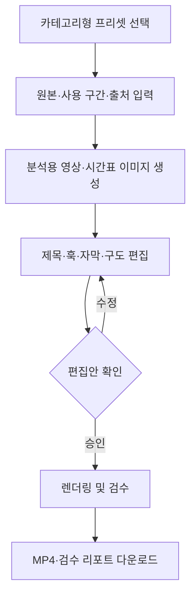
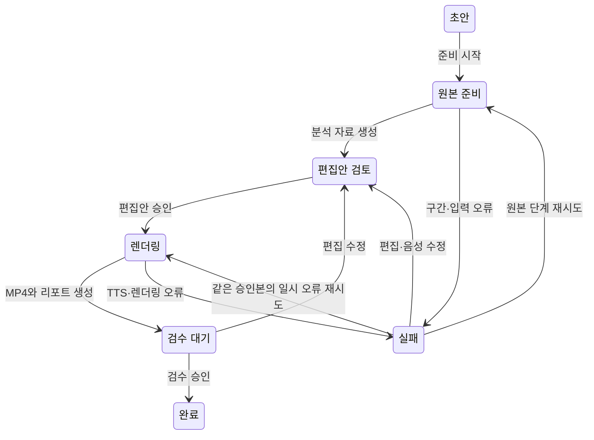

# Nomadroom Studio 카테고리형 쇼츠 제작 기획서

| 항목 | 내용 |
|---|---|
| 작성일 | 2026-11-18 · 한국 시간 |
| 문서 상태 | 구현 전 기획안 |
| 참조 | `카테고리형 영상제작_배포용 .zip`의 `SKILL.md`, `references/project-format.md`, `references/style.md`, `scripts/`, `tests/check.py` |
| 적용 위치 | Nomadroom Studio → 제작 → 새 영상 만들기 → 원테이크형 쇼츠 → 카테고리형 |
| 1차 목표 | 원본 한 편을 준비해 편집안을 승인하고, 한국어 카테고리형 MP4와 검수 리포트를 받는 과정 완주 |

## 1. 해결할 문제와 적용 범위

현재 Nomadroom에서 소재를 고른 뒤 카테고리형 제작을 시작할 수 있다. 이번 기획은 그 흐름에 **선택한 원본으로부터 검토 가능한 편집안을 만들고, 승인한 결과를 실제 MP4로 출력하는 기능**을 더한다. 배포본에서 검증한 Python·FFmpeg 렌더러와 편집 명세를 활용한다.

| 영역 | 이번 기획에서의 변경 |
|---|---|
| 소재수집(정체)·소재보관함 | 후보의 **영상 만들기**를 사용한다. 원본 링크, 제목, 소재 ID, 확인한 출처·권리 정보를 제작 작업에 연결한다. |
| 새 영상 만들기 | 기존 **카테고리형** 카드에 제작 옵션을 붙인다. 기존 원테이크형과 예능형 탭 구성 안에서 진입한다. |
| 소재·기획 | 원본 파일 또는 승인된 원본 경로, 사용할 구간, 제목, 공개 댓글 설정, 권리 기록을 확인한다. |
| 화면 편집 | 시간 표시 이미지 시트, 구간별 확대·위치, 제목과 자막, 댓글 카드와 출처의 미리보기를 제공한다. |
| 작업 중인 영상 | 준비·검토·렌더링 진행 상태와 오류 이유, 재시도, 산출물 다운로드를 표시한다. |
| 업로드 | 기존 검수·업로드 동선을 사용한다. 카테고리형 렌더링 완료는 게시 완료와 별개의 상태다. |

### 범위 결정

- **MVP** · 한국어 한 편, 원본 시간순 재생, 구간별 배율·위치, 제목 두 줄, 자막 세 종류, 첫 훅 음성, MP4와 리포트. 원본 파일과 훅 음성 파일을 첨부해 전체 과정을 먼저 검증한다.
- **연동 단계** · AI 제목·훅·자막 초안, 기존 댓글 설정과 출처 레이어, 승인된 URL 입력, 일본어 별도 출력. 앞 단계의 파일 입력 경로를 함께 제공한다.
- **후속 확장** · 1080×1920 출력 규격, 예능형 컷 재배치, 롱폼→복수 쇼츠, 동시 렌더링. 각각 출력 명세 변경이나 별도 승인 기준을 둔다.

## 2. 사용자 흐름과 화면 요구사항

| 화면 | 필수 입력과 동작 | 완료 상태 |
|---|---|---|
| 소재·기획 | 원본 파일 업로드 또는 기존 소재에서 선택. 원본 시작과 길이를 입력하고 출처·사용 권한 정보를 확인한다. | 원본 사본과 사용 구간이 작업에 연결된다. |
| 분석 보기 | 생성된 `analysis.json`의 장면 전환 후보와 0.5초 간격 이미지 시트를 표시한다. 정확한 구간 확인을 위해 원본 미리보기를 제공한다. | 사용자는 장면 후보를 재생해 컷·대사의 의미를 확인할 수 있다. |
| 편집안 | 제목 2줄, 첫 훅, 자막 유형·문구·구간, 컷별 확대 배율과 세로 오프셋을 수정한다. AI 연동 시 같은 양식에 초안을 채운다. | 유효성 검사 결과를 해당 입력 옆에 표시하고, 오류를 해결한 편집안을 승인할 수 있다. |
| 댓글·출처 | 기존 댓글 설정을 불러오고, 삽입할 댓글과 표시 구간을 확인한다. 편집안에 출처 명시 위치와 내용을 표시한다. | 자막·댓글·출처가 겹치면 해당 구간을 알려주고 다시 조정할 수 있다. |
| 작업·검수 | 준비 중, 검토 대기, 렌더링 중, 검수 대기, 완료, 실패를 표시한다. 실패한 단계의 이유와 재시도 경로를 제공한다. | MP4를 재생하고 검수한 뒤 다운로드할 수 있다. |

### 기존 기능과 충돌하기 쉬운 부분

| 항목 | 배포본 동작 | Nomadroom 적용 결정 |
|---|---|---|
| 댓글 | 카테고리형 기본 규격에는 댓글 카드가 없다. | 기존 프로젝트의 댓글 설정과 확정 문구를 유지한다. P0는 개발 검증 경로로 사용한다. 카테고리형 운영 경로에는 켜진 댓글 카드와 필요한 출처가 실제 출력에 반영되는 것을 P1에서 확인한 뒤 연결한다. |
| 자막·출처 | 제목과 자막을 그리며 댓글·일반 출처 표시는 기본 요소가 아니다. | 출처와 권리 기록을 작업에 보존한다. 필요한 표기는 승인된 위치에 반영한다. 원본의 권리 표기를 보존할 수 없는 구도는 수정 후 검수한다. |
| 쇼츠 규격 | 608×1080을 기준으로 좌표를 정의한다. | 첫 출력은 원래 규격을 따른다. 1080×1920은 높이·여백·폰트 크기를 함께 재정의하고 검증한 별도 프리셋으로 제공한다. |
| 원테이크·예능형 | 시간순 재생에서 컷별 화면 구도만 변경한다. | 카테고리형에 한정한다. 예능형 편집은 기존 프리셋 및 내보내기 경로를 사용한다. |
| 일본어 | 일본어 제목·훅·자막을 따로 작성한다. | 한·일판이 같은 원본 준비 결과를 공유하고 편집안·음성·MP4는 언어별로 저장한다. 승인과 실패 상태도 언어별로 추적한다. |

## 3. 프리셋 및 편집 데이터 명세

### 출력과 검수 기준

| 항목 | 기본 규격 |
|---|---|
| 영상 | 608×1080, 30fps, H.264, yuv420p MP4 |
| 오디오 | AAC, 48kHz, 192kbps 설정. 첫 훅 구간 원본 볼륨을 20%로 낮춘 뒤 복원하고 전체 음량을 정규화한다. |
| 구간 | 선택한 원본 구간을 최대 180초까지 준비한다. 첫 제작 테스트는 검수가 쉬운 15~18초 샘플을 사용한다. |
| 제목 | 상단 280px 검정 영역에 두 줄. 한국어판 흰색·노란색, 일본어판 흰색·흰색. |
| 자막 | 흰색 기본, 노란색 괄호, 초록색 강조 박스. 자막끼리 시간 중첩을 허용하지 않는다. |
| 구도 | 원본이 정규화된 프레임에서 컷별 확대와 세로 위치를 적용한다. 얼굴뿐 아니라 손·악기·제품 등 핵심 요소를 확인한다. |
| 음성 | 첫 훅만 음성 합성 또는 첨부 음성으로 제공한다. 이후에는 원본 음성을 사용한다. 원본이 무음이면 훅 이후도 무음이다. |

### 편집 명세와 작업 데이터

| 데이터 | 주요 필드 | 검증 기준 |
|---|---|---|
| 원본 자산 | `sourceAssetId`, 소재 ID, 원본 URL, 원본 시작 시각, 선택 길이, 출처·라이선스·확인 상태 | 원본 전체 기준 시작 시각과 선택 구간의 0초 기준 편집 시각을 각각 저장한다. |
| 편집안 | 스키마 버전, 리비전, 언어, `header`, `hook`, `duration` | 제목은 정확히 두 줄. 승인 후 입력 변경 시 새 리비전을 생성한다. |
| 구도 | 배포본의 `shots` = 시작·끝·배율·Y | 0초부터 끝까지 이어져야 하며, 빈 화면을 만드는 배율·Y는 오류로 처리한다. |
| 자막 | 배포본의 `items` = 시작·끝·종류·문구·선택 Y | 겹침과 범위 초과는 오류. 1.4초 미만 표시는 검토 경고. 첫 자막은 0초부터 시작한다. |
| 훅 음성 | 음성 자산 ID 또는 TTS 모델 설정, 실제 음성 길이 | `훅 길이 + 0.08초`가 첫 자막 구간 안에 들어와야 한다. 실패 시 훅을 줄이거나 첫 자막을 조정한다. |
| 추가 레이어 | 댓글·출처별 문구, 시작·끝, 화면 위치, 원본 참조 | 기존 댓글 선택을 보존하고, 다른 레이어와 화면을 가리는 문제를 검수한다. |
| 출력 작업 | 작업 ID, 승인 리비전, 언어, 프리셋 버전, 상태, 오류 단계, 결과 파일 ID | 동일 작업·리비전·언어의 중복 실행을 제어한다. 실패한 재시도가 이미 완료한 파일을 덮어쓰지 않도록 한다. |

Nomadroom이 승인한 편집안을 렌더링 어댑터가 배포본의 `project.json`으로 변환한다. MVP에서는 배포본과 호환되는 필드를 먼저 유지하고, 댓글·출처 레이어는 별도 필드와 렌더링 단계로 확장한다.

## 4. 구현 구성과 작업 상태

### 책임 분리

| 구성 | 책임 |
|---|---|
| Nomadroom UI | 소재 선택, 조건 입력, 편집안 수정·승인, 진행 상태와 다운로드 표시 |
| 제작 API | 사용자와 작업의 권한 확인, 편집안 저장, 승인 버전 고정, 작업 조회·재시도 |
| Python 워커 | 원본 준비, 시간표 이미지 생성, 훅 음성 처리, 프레임 합성 및 FFmpeg 인코딩 |
| 파일 저장소 | 원본, 분석 자료, 음성, MP4, 리포트를 작업별로 보관하고 권한에 따라 내려받기 제공 |
| AI 초안 생성 모듈 | 승인된 원본 구간과 분석 자료를 바탕으로 구조화된 편집 초안 작성. 사용자가 초안을 직접 고칠 수 있게 한다. |

### 상태 전이

- 웹 요청은 작업을 등록하고 상태를 반환한다. 인코딩은 별도 워커에서 실행한다. 개인용 첫 검증은 로컬 Python 워커 한 개로 시작한다.
- 워커는 사용자 입력의 파일 경로 대신 승인된 자산 ID를 작업 폴더의 파일로 변환한다. 외부 URL은 허용된 입력 방식으로 다루고, 접근 제한이 있으면 파일 업로드로 이어진다.
- 처리 오류에는 실패 단계와 사용자가 바꿀 수 있는 입력을 표시한다. 온라인 TTS가 실패하면 훅 문구와 편집안을 보존하고, 재시도 또는 훅 음성 파일 연결을 제공한다.
- 한국어·일본어 글꼴은 배포본의 이름과 버전을 기록한다. 폰트를 배포하는 구성에는 동봉된 글꼴 출처와 라이선스 문서를 유지한다.

## 5. 단계별 개발 계획과 완료 기준

| 순서 | 구현할 항목 | 단계 완료 기준 |
|---|---|---|
| P0 · 렌더러 연결 | 원본 파일·사용 구간·첨부 훅 음성 입력, 시간표 이미지, 카테고리형 편집안 폼, 한국어 MP4, 검수 리포트 | 기존 소재 한 건에서 제작을 시작해 승인한 편집안으로 MP4를 내보낸다. |
| P1 · 운영 기능 연결 | AI 구조화 초안, 댓글·출처 레이어, TTS 선택 및 대체 음성, 승인된 원본 URL | 댓글과 출처를 포함한 승인본을 렌더링하고, TTS 실패 또는 원본 링크 실패 후에도 작업을 이어갈 수 있다. |
| P2 · 일본어 확장 | 동일한 원본·구도를 재사용해 일본어 제목·자막·훅과 별도 작업 상태를 관리 | 동일 소재의 한국어판·일본어판이 각자 승인·검수·다운로드된다. |
| 후속 | 1080×1920 출력 프리셋, 예능형 재배치, 롱투숏 다중 출력, 작업 큐 용량 관리 | 새 프리셋별 실영상 검수와 기존 프리셋 회귀 테스트를 통과한다. |

### 인수 테스트

| ID | 확인 시나리오 | 기대 결과 |
|---|---|---|
| CAT-01 | 저장된 소재에서 카테고리형 시작 | 소재 ID, 제목, 원본 참조가 작업으로 전달된다. |
| CAT-02 | 30초 지점부터 15초를 선택 | 원본 시작은 30초로 기록하고 편집 타임라인은 0~15초로 시작한다. |
| CAT-03 | 구도 사이에 공백을 만들거나 자막을 겹치게 입력 | 어느 구간이 잘못됐는지 표시하고 렌더링을 막는다. |
| CAT-04 | 첫 자막에 들어가지 않는 훅 음성 입력 | 필요한 시간을 안내하며 편집안을 유지한다. |
| CAT-05 | 원본 음성이 있는 영상과 무음 영상 각각 출력 | 첫 영상은 훅 이후 원본 소리가 돌아오고, 무음 영상은 훅 이후 무음이 유지된다. |
| CAT-06 | 긴 제목·자막과 화면 가장자리에 피사체가 있는 원본 렌더링 | 글자 잘림, 검은 틈, 핵심 피사체 잘림을 검수한다. 실제 MP4 스트림의 코덱·해상도·프레임률·길이도 확인한다. |
| CAT-07 | 승인본 렌더링 중 같은 버튼을 다시 누르거나 실패 후 재시도 | 중복 출력이 제어되고, 실패한 단계에서 작업을 이어갈 수 있다. |
| CAT-08 | 댓글이 켜진 소재에서 댓글·출처 레이어 출력 (P1) | 댓글이 출력물에 실제 포함되고 자막·출처와 겹치지 않는다. 원본 참조도 유지된다. |
| CAT-09 | 같은 원본으로 한국어판과 일본어판 출력 (P2) | 두 MP4에 각 언어의 글꼴·자막·훅이 적용되며 서로 덮어쓰지 않는다. |
| CAT-10 | 기존 원테이크·예능형 작업 재실행 | 기존 프리셋의 진입, 편집, 댓글 설정, 내보내기가 정상 동작한다. |

## 6. 검증 근거와 미결정 사항

- ZIP의 SHA-256 목록 27개가 일치했다. 포함된 한·일 샘플은 각각 8초, 608×1080, 30fps, H.264/AAC였다.
- Linux에서 두 언어의 검증 테스트를 각각 6개 통과했다. 합성 원본 구간 추출, 이미지 시트 생성, 제공 음성을 사용한 한·일 MP4 재렌더링을 재현했다.
- 이번 확인은 합성 원본과 제공 음성을 사용했다. 온라인 Edge TTS, 실제 플랫폼 URL의 원본 확보, Nomadroom과 결합한 전체 실행은 다음 구현 단계의 검증 항목이다.
- 운영 전에 정할 사항은 작업 파일 보관 기간과 용량, 사용할 AI·TTS 제공자, URL 원본의 지원 범위다. MVP에서 고정한 608×1080은 해당 결정과 독립적으로 검증할 수 있다.
