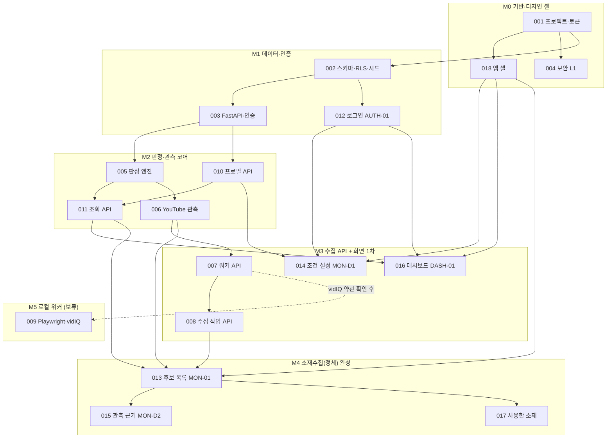

# 06 개발 단계 — Nomadroom Studio

> 작업 정본은 `tasks/README.md`(번호·선행·위험도·상태), 각 작업 상세는 `tasks/task-NNN.md`. 이 문서는 작업을 단계(M0~M5)로 묶고 단계별 데모·검증을 정한다.
> 시각 정본: `docs/design/Nomadroom_Dashboard_Design.html`(시안). 화면 명세: `docs/03_SCREENS_UX.md`.

## 1. 단계 표
| 단계 | 목표 | 작업 | 시안·화면 | 끝나면 보이는 데모 | 검증(위험도) |
|---|---|---|---|---|---|
| M0 기반·디자인 셸 | 모노레포·토큰·공통 레이아웃 | 001 → 018 · 004(병렬) | 시안 사이드바·상단 바·작업 탭 | `pnpm dev`에서 시안과 같은 사이드바·탭 셸을 3구간으로 확인 | 001·018 낮음 → design 리뷰, 004 높음 |
| M1 데이터·인증 | DB·RLS·API 인증·로그인 | 002 → 003 · 012 | AUTH-01 | 로그인 → 셸 안의 빈 대시보드. 다른 워크스페이스 데이터는 RLS 테스트로 차단 확인 | 높음: challenger 착수 전 + code·security 리뷰 |
| M2 판정·관측 코어 | 판정 규칙·프로필·조회·관측 | 005 · 010(병렬) → 011 · 006 | (API) | `pytest`로 PRD#9 판정 시나리오 통과. 시드 후보로 A-04가 제작 가능·근거 대기 반환. "기록 검증" 호출로 관측값 갱신 | 005 보통 → code, 나머지 높음 |
| M3 수집 API + 화면 1차 | 수집 job 흐름, 대시보드·조건 설정 | 007 → 008 · 014 · 016(병렬) | DASH-01 · MON-D1 | 대시보드 요약 4칸(3칸 "—")·정체 요약·최근 5건. 조건 설정 다이얼로그에서 저장 후 반영 | 높음 / 화면은 design 리뷰 추가 |
| M4 소재수집(정체) 완성 | 핵심 화면 | 013 → 015 · 017 | MON-01 · MON-D2 | 시안 흐름 재현: 프로필 선택(최대 3) → 기록 검증 → 지표 5개·칩 필터 → 후보 카드 → 관측 근거 → 사용한 소재 표시 | 높음 + design 리뷰 |
| M5 실제 후보 수집 | YouTube 검색으로 후보 수집(vidIQ 워커 009는 준비 중) | 019 | MON-01 후보 가져오기 | "후보 가져오기"로 실제 후보 유입(프로필 조건 → 검색 → 1차 관측·판정) | 높음 |

### 순서도
화살표 = 선행, 점선 = 보류 조건. 원본: [`diagrams/dev-stages.mmd`](diagrams/dev-stages.mmd) (수정은 원본에서 하고 아래 블록에 복사)

## 2. 병렬 묶음
| 단계 | 병렬 | 순서 |
|---|---|---|
| M0 | 018 ∥ 004 | 001 이후 |
| M1 | 003 ∥ 012 | 002 이후 |
| M2 | 005 ∥ 010 | 005·010 이후 011 · 006 |
| M3 | 008 ∥ 014 ∥ 016 | 007 이후(014·016은 M2 결과만 필요) |
| M4 | 015 ∥ 017 | 013 이후 |

- 선행은 같은 단계나 앞 단계에만 둔다(역행·순환 금지). 같은 파일을 쓰는 작업은 병렬로 보내지 않는다.
- 화면 작업(012~016)은 앱 셸을 만들지 않고 task-018 결과를 쓴다.

## 3. M5 보류 대안
- vidIQ 약관 확인이 끝날 때까지 M0~M4는 시드 데이터(task-002의 시안 예시 후보 5건 + 두 시점 관측값)로 끝까지 시연한다.
- 약관상 자동화가 불가하면 "후보 가져오기"를 YouTube `search.list`(100 unit/회)로 바꾸는 작업을 새로 만든다. → **결정(2026-11-17, 사용자): A안 채택 — task-019로 진행, vidIQ 워커(009)는 구현하지 않고 준비 중으로 둔다.**

## 4. 시안 정합 점검표
| 작업 | 시안 대비 누락 | 보완 |
|---|---|---|
| 앱 셸(사이드바·상단 바·작업 탭·외부 링크) | 맡은 작업 없음 | task-018 신규(W1) |
| 013·014·015 | 근거에 시안 HTML 없음 | 근거에 시안 HTML 추가 |
| 012~016 | 셸을 각자 만들 위험 | 하지 않을 것에 "셸 재구현 금지(task-018 사용)" |
| 데모 데이터 | task-009 보류로 후보 유입 없음 | task-002 시드에 예시 후보 5건 + 두 시점 관측값 |

시드 예시 후보 5건: 시안 예시 기준(예능·스포츠·영화·드라마·일상), 한국 4·일본 1, 이전 관측 없는 1건·사용한 소재 1건 포함. 개발·데모용(`supabase/seed.sql`만).

## 5. 진행 현황 갱신 규칙
단계가 끝날 때마다 `README.md`의 `### 작업 진행률`·`### 다음 개발 단계` 체크를 함께 갱신한다.
